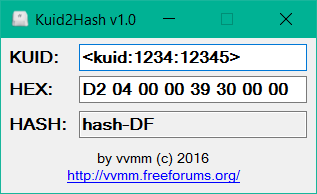

# Trainz Kuid2Hash

  

This application helps you identify the folder in the Trainz Assets Database which holds a particular asset without using Content Manager.

Features:

- Translates numeric KUIDs to hexadecimal
- Translates hexadecimal KUIDs to decimal
- Calculates the hash for a specific KUID -> Used to identify the directory in which a particular Trainz asset is stored

Screenshot:

Project is built with .NET 10

System requirements: Windows 10 or newer
