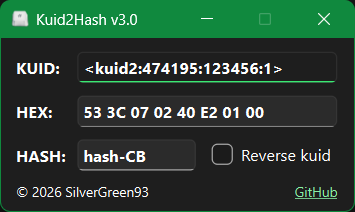

# Trainz Kuid2Hash

[](https://github.com/SilverGreen93/Kuid2Hash/releases/latest) [](https://github.com/SilverGreen93/Kuid2Hash/releases/latest) 

This application helps you identify the folder in the Trainz Assets Database which holds a particular asset without using Content Manager.



## Features

- Translates numeric KUIDs to hexadecimal
- Translates hexadecimal KUIDs to decimal
- Calculates the hash for a specific KUID -> Used to identify the directory in which a particular Trainz asset is stored

See more about the KUID Format Specification here: [KUID Format Specification](https://github.com/SilverGreen93/CDPExplorer/blob/master/kuid-format.md)

## Usage

The app runs as a GUI when started without arguments, and as a command line tool when arguments are given.

Run it directly from the source tree (no packaging needed), after [installing it in editable mode](#building-from-source):

```
kuid2hash                    # starts the GUI
python -m kuid2hash.cli      # same thing without installing the script entry point
```

CLI examples:

```
$ kuid2hash "kuid 68787 1097"
kuid:  <kuid:68787:1097>
hex:   B3 0C 01 00 49 04 00 00
hash:  hash-F3

$ kuid2hash "B3 0C 01 00 49 04 00 00"
kuid:  <kuid:68787:1097>
hex:   B3 0C 01 00 49 04 00 00
hash:  hash-F3
```

A single kuid may be passed quoted (`"kuid 68787 1097"`) or as separate tokens (`kuid2 328583 1373 2`). Hex kuids (4 bytes for `uid -1`, 8 bytes otherwise, separated by space/dash/colon/comma) are detected automatically.

## Building from source

Requires Python 3.10+.

```
python -m venv .venv
.venv\Scripts\pip install -e ".[gui,test]"     # Windows (use bin/activate on unix)
pytest                                          # run the tests
```

## Packaging

`build.py` builds distributable packages for the host OS:

| Platform | Artifact | Requirement |
|----------|----------|-------------|
| Windows  | `dist/Kuid2Hash.exe` (one-file, GUI + CLI) | `pip install ".[gui,build]"` |
| macOS    | `dist/Kuid2Hash-<ver>-macos.dmg` | `pip install ".[gui,build]"` |
| Linux    | `dist/kuid2hash_<ver>_amd64.deb` and `.pkg.tar.zst` | `gem install fpm` |

```
python build.py                 # build everything this host supports
python build.py --only exe      # build a single artifact
```

PyInstaller cannot cross-compile, so each artifact must be built on its target OS. The GitHub Actions workflow in `.github/workflows/release.yml` builds all four packages (Windows exe, macOS dmg, Linux deb and zst) automatically on every `v*` tag and attaches them to the release.

## System requirements

- Windows 10 or newer, macOS 12+ (Apple Silicon/Intel), or any recent Linux with Python 3.10+
- The GUI packages bundle PySide6 (Qt 6); the deb/zst packages depend on the system Python and expect `PySide6` to be installed for GUI use (`pip install PySide6-Essentials`)
